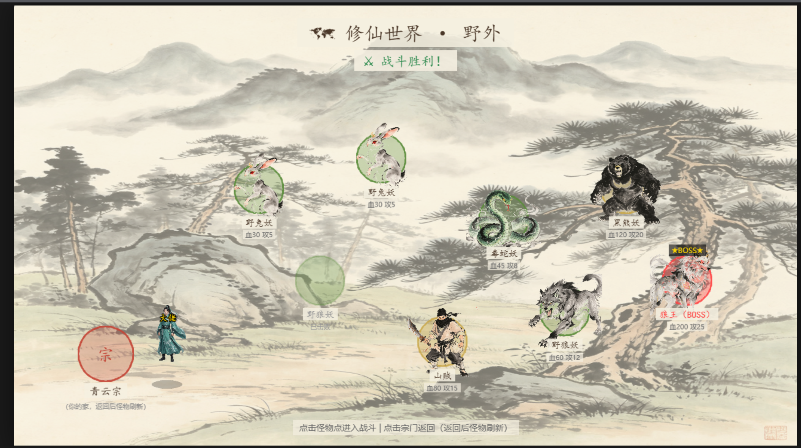

# 修仙录 · Xiuxian Game

[](LICENSE)


**中文** | [English](README.en.md)

一款用 **Phaser 3 + 原生 JavaScript** 写的水墨风修仙网页游戏。无构建步骤、无框架、无依赖管理——`index.html` 双击就开的纯前端项目。

<div align="center">
  
  <p><sub>世界大地图 —— 点击妖兽点进入战斗，点击宗门返回</sub></p>
</div>

---

## 玩法概览

- **宗门主地图**：洞府、宗门灵田、练功台、宗门大殿、功法阁、野外大门，点击进入
- **世界大地图**：8 个妖兽点（含 1 个 BOSS 狼王），打完标记"已击败"，按各自 `respawnTime` 自动刷新
- **站桩回合制战斗**：选技能 → 耗灵气 → 打伤害 → 敌方回合回灵气；支持丹药、逃跑、熟练度成长
- **修炼体系**：炼气期 → 筑基期 → 金丹期，每个大境界 9 层；7 部功法、10 个技能，功法决定可用技能与加成
- **种田**：洞府灵田 + 宗门灵田两套，3 种灵植，4 个生长阶段（有专属贴图）
- **宗门系统**：任务殿（采集 / 讨伐任务）、珍宝阁（灵石买丹药）、功德堂（贡献换功法）
- **储物戒 + 仓库**：50 格背包 + 独立仓库，六品级配色（凡 / 良 / 上 / 极 / 仙 / 神）
- **存档**：3 个存档位，LocalStorage 持久化，10 秒自动存档

## 技术栈

| 项目 | 说明 |
|---|---|
| 引擎 | [Phaser 3.70](https://phaser.io/)，走 CDN |
| 语言 | 原生 ES6+（无 TypeScript、无打包器） |
| 渲染 | WebGL / Canvas 自动降级 |
| 持久化 | `localStorage` |
| 资源 | 图片以 base64 内嵌在 `*_data.js` 中，绕开 `file://` 的 CORS 限制 |
| 美术 | 水墨风：宣纸底 `#f5f0e1`、朱砂 `#c44536`、石青 `#3a6b8c`、泥金 `#c9a84c` |

## 运行

### 方式一：本地服务器（推荐）

> **不能直接双击 `index.html`。** 储物戒背景通过 CSS `url()` 引用 `assets/images/ui/inventory_bg.png`，在 `file://` 协议下会被浏览器 CORS 策略拦掉。

```bash
# 任选其一
npx serve . -l 8000
python -m http.server 8000
```

然后打开 <http://localhost:8000>

### 方式二：打包成静态站点

项目无构建步骤，任意静态托管（GitHub Pages / Vercel / Netlify）上传整个目录即可。仓库体积较大（约 154 MB，其中 82 MB 为 base64 资源），首次克隆会慢一些。

## 目录结构

```
xiuxian-game/
├── index.html               # 唯一入口：内联样式 + 按顺序引入所有脚本
├── src/
│   ├── main.js              # Phaser 实例、场景注册、全局点击事件总线
│   ├── config/constants.js  # 全部数值表：境界/功法/技能/物品/怪物/种子
│   ├── modules/player/      # 玩家：属性、突破、丹药、熟练度、技能装备
│   ├── scenes/              # 10 个场景（登录/主地图/大地图/战斗/洞府/灵田…）
│   ├── battle/              # 回合制战斗
│   ├── farm/                # 农田生长与品质
│   ├── inventory/           # 背包数据 + 储物戒 UI
│   ├── systems/             # 存档、事件总线
│   └── ui/                  # 状态栏 / 面板 / 功法面板
├── assets/
│   ├── images/              # 原始 PNG + 7 个 base64 打包的 *_data.js
│   └── custom/              # 自定义素材槽位（含 manifest.json）
├── editors/                 # 三个浏览器内开发工具（见下）
└── docs/screenshots/        # README 用截图
```

## 自带开发工具

`editors/` 下三个纯 HTML 工具，双击即用，帮助批量产出内容：

| 工具 | 用途 |
|---|---|
| `asset-generator.html` | 程序化生成水墨风素材 PNG（地形 / 建筑 / 装饰 / 交互点） |
| `map-editor.html` | 摆放置、锁定素材、导入自定义素材、导出 JSON |
| `ui-designer.html` | 拖拽设计 UI 面板布局，导出 JSON |

> 内置快捷键：游戏内按 **F2** 打开编辑器面板。

## 已知问题（Known Issues）

项目已归档，以下问题**已知但未修复**，留作后续更新清单：

| # | 问题 | 位置 |
|---|---|---|
| 1 | 灵田 / 宗门大殿内的操作不落盘：`saveGame()` 依赖从未被赋值的 `window.gameState.saveSlot` | `FarmScene.js:520` / `SectHallScene.js:697` |
| 2 | "存档管理"面板的保存按钮失效：`saveToSlot()` 只传 1 个参数，`inventory.toJSON()` 抛异常 | `BaseMapScene.js:959` / `SaveSystem.js:51` |
| 3 | 大境界突破不可达：`tryBreakthrough()` 无 UI 入口、无调用者 | `Player.js:245` |
| 4 | 修为（exp）几乎无来源：练功台不产修为，唯一入口是悟道丹 | `TrainingGroundScene.js` |
| 5 | "妖兽讨伐"任务永不完成：`killCount` 只读不写 | `BaseMapScene.js:1589` |
| 6 | 任务奖励用了不存在的物品 ID（`lingshi` / `ling_cao_seed`），产生不可见幽灵物品 | `BaseMapScene.js:1627` |
| 7 | 种田不消耗种子，种子可无限使用 | `FarmManager.js:126` |
| 8 | 玩家 `attack` / `defense` 未参与战斗公式，数值成长无实际手感 | `BattleScene.js:684` |
| 9 | 寿元系统未接线：`trainingPerSecond` 无引用，寿元恒为 100 | `constants.js:42` |
| 10 | 调试资源常开：每次回主地图自动补满 1 万灵石 + 1 万贡献 + 丹药 | `BaseMapScene.js:143` |

完整评审记录见提交历史中的问题清单。**这个项目是一个可玩的半成品**，主流程（登录 → 宗门 → 大地图 → 战斗 → 掉落 → 种田 → 商店）能跑通，但存档与修炼主线尚未闭环。

## 许可

[MIT](LICENSE) © 2026 1250717553-glitch
